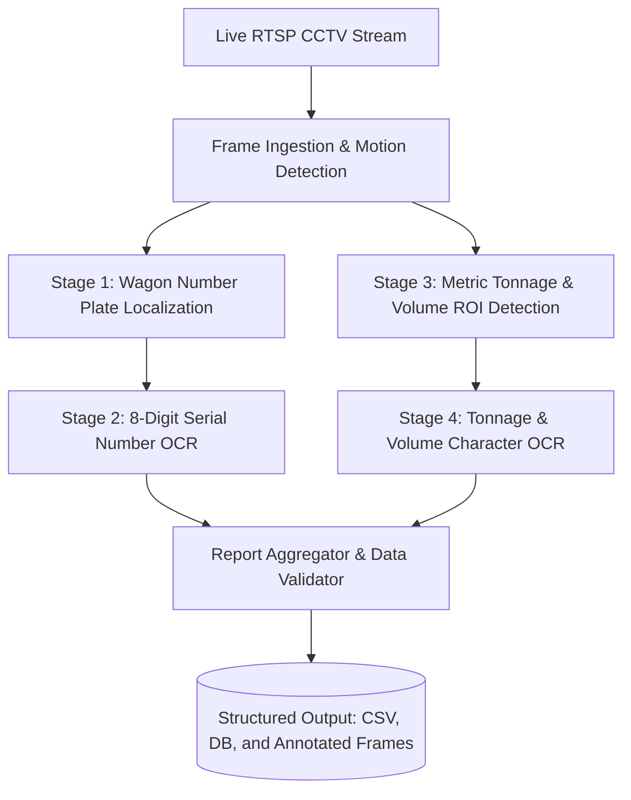

# 🚂 RailWagon Vision AI · Industrial Railway Telemetry & OCR Engine

[](https://python.org)
[](https://pytorch.org)
[](https://ultralytics.com)
[](https://openvino.ai)
[](https://opencv.org)
[](LICENSE)

An enterprise-grade, 24/7 edge computer vision system for real-time tracking, classification, and Optical Character Recognition (OCR) of railway freight cars from live RTSP CCTV feeds. Automatically identifies **8-digit wagon serial numbers**, **carrying capacity (tonnage)**, and **hull volume (m³)**.

---

## 📑 Table of Contents
- [Overview & Industrial Context](#-overview--industrial-context)
- [System Architecture](#-system-architecture)
- [Multi-Stage Deep Learning Pipeline](#-multi-stage-deep-learning-pipeline)
- [Installation & Setup](#-installation--setup)
- [Execution Modes](#-execution-modes)
- [24/7 Production Daemon (Systemd)](#-247-production-daemon-systemd)
- [Contact](#-contact)

---

## 🎯 Overview & Industrial Context

Freight rail logistics across heavy industries (coal mining, chemical manufacturing, metallurgical plants) requires non-stop monitoring of train movements, cargo capacity auditing, and automated railcar asset logging under all weather and lighting conditions.

**Core Capabilities:**
* **Automated 8-Digit Serial Recognition:** Pinpoints and deciphers official railway fleet serial plates.
* **Tonnage & Volume Extraction:** Parses painted technical specifications (carrying capacity in tons and volume in cubic meters).
* **24/7 Autonomous Stream Processing:** Continuous RTSP monitoring with motion-triggered detection windows and automatic session report generation upon train departure.
* **Edge Hardware Optimization:** Powered by Intel OpenVINO runtime for accelerated FP16/INT8 inference on edge hardware.

---

## 🏗 System Architecture



---

## 📦 Multi-Stage Deep Learning Pipeline

| Pipeline Stage | Function | Model Architecture | Hardware Acceleration |
|---|---|---|---|
| **Wagon Plate Detector** | Localizes wagon serial plate ROI | Fine-tuned YOLOv8 Nano | CUDA / OpenVINO |
| **Serial Number OCR** | Transcribes 8-digit serial number | Specialized Character Classifier | CUDA / OpenVINO |
| **Technical Spec Detector** | Localizes metric tonnage (t) and volume (m³) | Fine-tuned YOLOv8 Medium | CUDA / OpenVINO |
| **Technical Spec OCR** | Decodes payload capacity & volume numbers | Deep Character Classifier | CUDA / OpenVINO |
| **OpenVINO Edge Model** | High-throughput edge inference | Intel OpenVINO IR (`.xml`/`.bin`) | Intel Core / Xeon / iGPU |

---

## 💻 Installation & Setup

### 1. Clone the Repository:
```bash
git clone https://github.com/quvonchbek212/rail-wagon-vision-ai.git
cd rail-wagon-vision-ai
```

### 2. Environment Setup:
* **Linux (Ubuntu/Debian):**
  ```bash
  chmod +x install.sh run.sh
  ./install.sh
  ```
* **Windows (PowerShell / CMD):**
  Run `install.bat` (automatically configures `.venv`, verifies PyTorch GPU drivers, and installs required packages).

---

## 🚀 Execution Modes

```bash
# 1. Real-time RTSP CCTV Stream (Production 24/7)
./run.sh "rtsp://<username>:<password>@<camera_ip>:<port>/stream"

# 2. Local USB / Web Camera
./run.sh 0

# 3. Video File Analysis
./run.sh train_passage_sample.mp4

# 4. Headless Server Mode (Disables GUI window for server environments)
./run.sh --headless "rtsp://<username>:<password>@<camera_ip>:<port>/stream"
```

---

## ⚙️ 24/7 Production Daemon (Systemd)

To install as an autonomous background service that restarts automatically on system boot:

```bash
./install.sh --service "rtsp://<username>:<password>@<camera_ip>:<port>/stream"

# Service Monitoring:
sudo systemctl status vagon-detect
journalctl -u vagon-detect -f
```

---

## 📬 Contact

* **Author:** Quvonchbek Begimqulov
* **LinkedIn:** [linkedin.com/in/quvonchbek212](https://www.linkedin.com/in/quvonchbek212/)
* **Email:** [begimqulovquvonchbek53@gmail.com](mailto:begimqulovquvonchbek53@gmail.com)
* **GitHub:** [@quvonchbek212](https://github.com/quvonchbek212)
